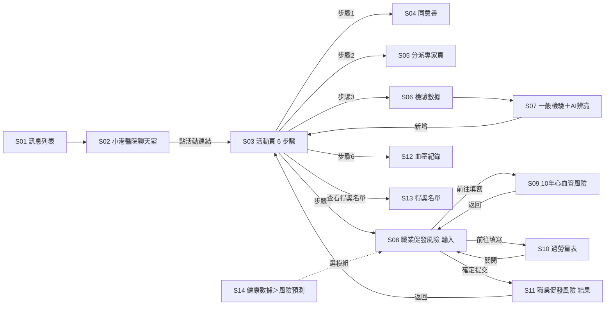

# 小港醫院「職場心健康」活動頁＋職業促發腦心血管疾病風險 快速確認

日期：2026-10-13　模式：A 已有 prototype
來源：
- 本機專案 `wacare-occupational-health`（最新 commit 3cbbcd2，本機建置後實際操作）
- Vercel 連結 https://wacare-occupational-health.vercel.app/（有開啟，但見下方版本提醒）
- 資料夾內文件：`docs/修改總覽.html`、`docs/與線上版差異清單.html`

> **版本提醒**：Vercel 上的版本比本機舊。Vercel 活動頁是 5 步驟（步驟 3 為「填寫問卷」），本機 3cbbcd2 是 6 步驟（新增「AI 辨識檢驗（選填）」）。本文件以本機 3cbbcd2 為準。要給別人看連結前，請工程重新部署。

> **「全新發現」的依據**：你沒有另外貼既有規格，但資料夾裡的《與線上版差異清單》有「線上現況」欄（2026-10-12 讀取線上活動頁）。我用這一欄當既有規格比對；如果你不認可它當規格，請把「全新發現」標籤刪掉。

> **缺臨床規則表**：你沒有提供附出處的臨床規則或門檻表。prototype 和兩份文件裡的數字（過勞門檻、加班時數、CVD 分級、面談矩陣、血壓分級等）都還不能當規格，全部列入待拍板表，不寫進 AC。

## 怎麼看這份文件

每張卡片是 prototype 上的一個畫面。狀態標籤：

- **已確認**：我實際看到或點到，行為清楚。
- **待確認**：需要醫療部或指定的人拍板，答案見最下方「待拍板表」。
- **全新發現**：prototype 有、差異清單「線上現況」寫沒有。
- **未能實測**：我沒辦法點到或看到，所以不描述行為，只寫原因。

## 畫面連結圖

實線＝實際點過的跳轉；虛線＝看到入口但沒點完整流程。

## 畫面卡

### S01　訊息列表　【已確認】
- 情境：在職勞工打開 App 的「訊息」，看到小港醫院-職場健康傳來的活動訊息。
- 實際觀察到的行為：
  - 列出「小港醫院-職場健康」「Wa 邦尼 人工智慧」「林小華」三則對話（示範資料）。點小港醫院進入 S02。
- 缺漏狀態：Empty 無（未觀察到）；Loading 無（未觀察到）；Error 未能實測（原型沒有後端）
- 發現落差：無
- 待確認：無

### S02　小港醫院-職場健康 聊天室　【已確認】
- 情境：勞工收到醫院的活動邀請訊息，點連結進入活動頁。
- 實際觀察到的行為：
  - 訊息內容是活動介紹與連結；點連結進入 S03。
  - 第二則訊息「步驟一：確認加入的計畫名稱？」有三個選項（家醫計畫、代謝症候群計畫、其他）。點「家醫計畫」後畫面沒有變化。
  - 底部「預約諮詢」點了會進入 S03 活動頁。「客服協助」未能實測（點擊時頁面已跳轉）。
- 缺漏狀態：Empty 無；Loading 無；Error 未能實測
- 發現落差：「預約諮詢」進入的是抽獎活動頁，不是預約流程（是不是刻意的，請產品確認，屬非臨床題，列給工程的備註）。
- 待確認：無

### S03　活動頁「職場心健康」（6 步驟）　【已確認】
- 情境：在職勞工（活動頁寫「參加資格：在職的勞工朋友」）想參加活動，依步驟完成同意、打招呼、評估、收案，之後每天量血壓參加抽獎。
- 實際觀察到的行為：
  - 頁面有活動說明、得獎名單隱私聲明、6 個步驟、獎項說明、常見問題。「我要參加」會捲動到步驟區。
  - 每步驟顯示「尚未完成／已完成」；完成後「點擊前往」按鈕變成不可按。
  - **步驟之間沒有先後鎖定**：重新開始時，沒簽同意書也能直接進步驟 4 填健康資料（見 Q2）。
  - 步驟 3 標「選填」，寫「可略過，完成後問卷自動帶入數據」。
  - 步驟 5「點擊收案」：前置未完成時只顯示「尚未完成」，沒有按鈕；完成步驟 1、2、4 後出現按鈕（程式碼確認不看步驟 3）。按下後提示「收案成功！您已正式加入小港醫院職場心健康計畫（原型示範）」，並顯示「每日還可以賺取健康獎金」。
  - 步驟 6 量完血壓回到活動頁，不會顯示當天已完成（見 Q20）。
- 缺漏狀態：Empty 不適用；Loading 無（未觀察到）；Error 未能實測
- 發現落差：
  - 步驟 5 寫「賺取健康獎金」，活動說明寫「每日抽兩名 100 元超商禮券」，用詞不一致（Q19）。
  - 步驟 3、4 的說明圖是 App 截圖，正式圖待設計提供（差異清單待確認 6，列給工程的備註）。
- 待確認：Q2、Q4、Q18、Q19、Q20

### S04　研究參與同意書（彈窗）　【已確認】
- 情境：勞工在參加前閱讀「勞動者心血管健康世代研究」同意書並簽署。
- 實際觀察到的行為：
  - 兩個勾選框：「我已閱讀並同意上述內容」「我同意將剩餘檢體授權後續研究使用」。**兩個都勾才能按「我同意」**，只勾一個按鈕仍是灰色。
  - 按「我同意」：關閉彈窗、提示「研究參與同意書已簽署完成（原型示範）」、步驟 1 變已完成。
  - 按「不同意並返回」：關閉彈窗、提示「已取消同意書簽署，步驟維持尚未完成」。
- 缺漏狀態：Empty 不適用；Loading 無（未觀察到）；Error 未能實測
- 發現落差：同意書寫「由專業醫護人員自指尖採集少量血液（20ml 以下）」，指尖採血與 20ml 的量看起來對不上（Q5）。
- 待確認：Q1、Q5

### S05　分派專家頁（職場健康-個管師／AI專家）　【已確認】
- 情境：勞工完成「跟專家打招呼」，追蹤被分派的專家帳號。
- 實際觀察到的行為：
  - 點步驟 2，系統以各 50% 機率分派「職場健康-個管師」或「職場健康-AI專家」，同一次使用中固定同一位（程式碼確認）。本次實測分派到 AI專家。
  - 按「追蹤」後自動回到活動頁，步驟 2 變已完成。步驟寫的「收到專家訊息」「分享個人數據」不是完成條件。
- 缺漏狀態：Empty 不適用；Loading 無；Error 未能實測
- 發現落差：步驟說明列了三件事，實際只要追蹤就算完成（Q17）。
- 待確認：Q17

### S06　檢驗數據＋新增數據選單　【已確認】
- 情境：勞工要上傳健檢報告，從步驟 3 進入檢驗燈。
- 實際觀察到的行為：
  - 進入後直接跳出「新增數據」選單：一般檢驗、眼底鏡檢查。選「一般檢驗」進入 S07。
- 缺漏狀態：Empty 有畫面但列表區只有空白，沒有提示文字；Loading 無；Error 未能實測
- 發現落差：無
- 待確認：無

### S07　一般檢驗表單＋AI 辨識　【全新發現】
- 情境：勞工拍下健檢報告，讓 AI 辨識數值，供後續風險評估自動帶入。
- 實際觀察到的行為：
  - 手動表單分一般檢查、糖尿病、血脂肪、肝、腎、胰臟功能、其他（阿斯匹林、肝功能指標）。
  - 「AI辨識」→ 選拍照上傳／檢視圖庫／上傳報告。選拍照進入模擬相機（示範用去識別化報告），拍照後可「重新拍攝」或「使用照片」。
  - 辨識結果列出 13 項，每項可修改，並有「重新辨識」「新增」。按「新增」回到活動頁，步驟 3 變已完成。
  - 辨識值之後會自動帶入 S09（總膽固醇、HDL、收縮壓、肌酸酐；BMI 由身高體重算出）。
- 缺漏狀態：Empty 不適用；Loading 未觀察到辨識中的畫面；Error 辨識失敗未能實測（原型固定成功）
- 發現落差：
  - 報告上的異常標記（收縮壓、飯前血糖、肌酸酐前有 *）在辨識結果中沒有顯示（Q16）。
  - 欄位名稱與單位：「HLD-C」疑為 HDL-C；ALB 白蛋白單位寫 mg/dl；多處「脢」字（Q15）。
- 待確認：Q15、Q16

### S08　職業促發腦心血管疾病風險（輸入頁）　【全新發現】
- 情境：勞工要評估工作負荷是否會促發腦心血管疾病，模組先帶入既有資料，再補填加班與工作型態。
- 實際觀察到的行為：
  - 頁首寫「本評估依勞動部《異常工作負荷促發疾病預防指引》（第二版，108 年 4 月）計算」。
  - 兩區自動帶入：「10 年心血管高風險預測」（顯示 CVD 風險與填寫日期）、「職場問卷-過勞量表」（顯示兩個分數與填寫日期）。沒資料時顯示「尚無資料」＋「前往填寫…」按鈕，填完返回本頁會看到帶入結果。
  - 補填：月加班時數（近 6 個月平均，小時）、工作型態六項可複選，每項附定義。
  - 兩份資料齊、月加班有填才能按「確認並計算」。月加班輸入 500 時按鈕維持灰色，沒有提示文字。
  - 按「確認並計算」→ 跳出「提交後將無法修改」→「確定提交」才產生結果。
- 缺漏狀態：Empty 有（尚無資料＋前往填寫）；Loading 無；Error 超出範圍只有按鈕變灰，沒有錯誤提示
- 發現落差：無臨床規則表可比對；文件中「月加班 0–400」為 prototype 值（Q9）。
- 待確認：Q2、Q9

### S09　10 年心血管風險預測（既有模組，被 S08 引用）　【已確認】
- 情境：勞工補填 10 年 CVD 風險資料，讓 S08 可以計算。
- 實際觀察到的行為：
  - 欄位：性別、年齡、總膽固醇、HDL、收縮壓、BMI、肌酸酐、糖尿病史、吸菸、高血壓治療、statin。每個數值欄下有「適用範圍」。
  - 年齡填 25（超出範圍）時「計算」按鈕變灰，沒有錯誤文字。
  - 按計算 →「提交後將無法修改」確認 → 個人資料沒有性別年齡時，問要不要更新個人資料 → 結果頁（10 年／30 年 CVD、ASCVD、HF，推算的 eGFR，風險分級與健康建議）。
- 缺漏狀態：Empty 不適用；Loading 無；Error 超出範圍無提示
- 發現落差：
  - 頁面寫依 AHA PREVENT 估算，但結果頁 Reference 列的是 Framingham 與 WHO 文獻（Q12）。
  - 結果頁用「10 年 ASCVD <5% 低風險」分級，S11 用「10 年 CVD」分三級，兩套分級並存（Q12）。
  - 收縮壓帶入的是檢驗報告值，S10 過勞量表帶入的是血壓燈值，兩處來源不同（Q6）。
- 待確認：Q6、Q12、Q13

### S10　職場問卷-過勞量表　【已確認】
- 情境：勞工補填過勞量表，讓 S08 可以計算。
- 實際觀察到的行為：
  - 4 頁：說明 → (一) Q1–7 心血管基本資料 → (二) Q8–13 個人相關過勞 → (三) Q14–20 工作相關過勞 → 送出。
  - Q1–3 預帶血壓燈數值、Q4 預帶檢驗的總膽固醇，可修改。
  - 本頁必填沒完成時「下一頁」是灰色。按「下一頁」後內容回到頂部。
  - 送出後顯示個人過勞與工作相關過勞分數與分級文字（嚴重、中度…），有「刪除」「查看 & 編輯」與「編輯紀錄」分頁。關閉後回到 S08 並自動帶入。
- 缺漏狀態：Empty 不適用；Loading 無；Error 未完成必填時只有按鈕變灰
- 發現落差：
  - Q20「不工作的時候，你有足夠的精力陪朋友或家人嗎？」選項卻是「很嚴重～很輕微」（Q8）。
  - 說明頁寫「修訂日期：115年4月10日」，S08 寫指引「第二版 108 年 4 月」（Q21）。
  - Q5 選項「戒斷打六個月」錯字（Q15）。
  - 量表可刪除、可編輯；S08 結果卻「提交後無法修改」，若量表事後被改，已出的風險結果不會跟著變（列給工程的備註）。
- 待確認：Q6、Q7、Q8、Q15、Q21

### S11　職業促發腦心血管疾病風險（結果頁）　【全新發現】
- 情境：勞工看到自己的綜合風險與是否需要面談。
- 實際觀察到的行為（實測：CVD 3.19%、個人過勞 75、工作過勞 50、加班 30、工作型態 0 項）：
  - 依序顯示：填寫日期、風險等級色塊（中度風險）、您的輸入數據（含各資料日期）、風險評估表、建議。
  - 面談建議：「需要面談」，下一行原因「工作負荷為高負荷（主要來自個人過勞），綜合風險為中度風險。」
  - 再下面是個人／工作相關過勞說明、指引出處與「結果僅供參考，不構成醫療診斷或治療建議」。
  - 按返回回到活動頁，步驟 4 變已完成。
  - 結果頁沒有任何下一步動作（預約、通知職醫、聯絡個管師）。
- 缺漏狀態：Empty 不適用；Loading 無；Error 未能實測
- 發現落差：
  - 門檻與矩陣無臨床規則表可比對（Q3）。
  - 風險評估表 CVD 列寫「低（0 分）」，其他列寫「低負荷」等，用詞不一致（Q10）。
- 待確認：Q3、Q4、Q10、Q11

### S12　血壓紀錄＋輸入面板　【已確認】
- 情境：收案後勞工每天量血壓，參加當日抽獎。
- 實際觀察到的行為：
  - 從步驟 6 進入，頁面有趨勢圖、歷史紀錄（每筆有分級標籤：普通／留意／緊急），並直接開啟輸入面板。
  - 面板：日期時間、收縮壓、舒張壓、心律、數字鍵盤、拍照上傳、藍牙上傳、備註、取消、完成。按完成提示「血壓量測紀錄已成功儲存！」，新紀錄出現在列表最上方。
- 缺漏狀態：Empty 未觀察到（有示範資料）；Loading 無；Error **無**：舒張壓輸入 827 仍可存檔，並標成「緊急」
- 發現落差：示範紀錄 106/84 標「留意」、123/85 標「普通」，分級看起來不一致；沒有規則表可比對（Q14）。
- 待確認：Q14、Q20

### S13　得獎名單　【已確認】
- 情境：勞工查看每日中獎者。
- 實際觀察到的行為：顯示開獎日期、遮蔽姓名、遮蔽電話、獎項（示範資料），有「返回活動說明」「我也要參加抽獎」。兩個按鈕未點測。
- 缺漏狀態：Empty 未觀察到；Loading 無；Error 未能實測
- 發現落差：聲明寫電話遮蔽為「0912XXX678」，名單顯示「0912-***-456」，遮蔽格式不同（非臨床，列給工程的備註）。
- 待確認：無

### S14　健康數據＞風險預測列表　【已確認】
- 情境：勞工從健康數據頁自己開啟風險預測。
- 實際觀察到的行為：
  - 沒紀錄時顯示「目前尚無風險預測紀錄／點擊右上角新增預測」。
  - 右上角「＋」列出模組：DCSI 糖尿病風險預測（此功能目前無法使用）、10 年心血管高風險預測、職業促發腦心血管疾病風險。
  - 從這裡選模組之後的流程，以及提交後列表顯示紀錄，本次未實測。
- 缺漏狀態：Empty 有；Loading 無；Error 未能實測
- 發現落差：無
- 待確認：無

## 本輪臨床釐清問答（第 1 輪，共 4 題）

請直接回「1 是、2 改成…」即可。

1. **檢體再利用要不要改選填？** 現在同意書兩個勾選框都必勾，包含「剩餘檢體授權後續研究使用」，不勾就不能參加。要維持必勾，還是改成不勾也能參加？（以 IRB 核定版本為準）
2. **未簽同意書前，能不能先填健康資料？** 現在步驟 2–4 都不用先完成步驟 1。是否要求先簽同意書，才能進入步驟 2–4？
3. **職業促發風險的門檻與面談矩陣，是否照下表採用？**（建議預設來自差異清單卡片 06／修改總覽 §6，該文件寫「依勞動部《異常工作負荷促發疾病預防指引》第二版 108.04」；我沒有原指引可對照，請職醫核對）

   | 項目 | 低 | 中 | 高 |
   |---|---|---|---|
   | 個人過勞分數 | <50 | 50–70 | >70 |
   | 工作相關過勞分數 | <45 | 45–60 | >60 |
   | 月加班時數 | <45 | 45–80 | >80 |
   | 工作型態項數 | 0–1 | 2–3 | ≥4 |
   | 10 年 CVD 風險 | <10%（0 分） | 10–20%（1 分） | >20%（2 分） |

   工作負荷取四項最嚴重者；綜合風險＝CVD 分＋負荷分（0 低度、1–2 中度、3–4 高度）；面談矩陣：低負荷［不需、不需、建議］、中負荷［不需、建議、需要］、高負荷［建議、需要、需要］。
4. **結果是「建議面談」或「需要面談」時，系統接下來要做什麼？** 現在只顯示文字，沒有預約、通知或轉介。

## 待拍板表

Q1–Q4 是本輪問答；Q5 以後可以之後再回。

| # | 問題 | 回指畫面 | 建議預設（附出處） | 回答者 | 回覆 |
|---|---|---|---|---|---|
| Q1 | 「剩餘檢體授權後續研究使用」要維持必勾，還是改選填？ | S04 | 無，請直接回答（prototype 現為必勾） | 計畫主持人／醫療部（依 IRB 核定版） | |
| Q2 | 未完成步驟 1 同意書前，是否禁止進入步驟 2–4？ | S03、S08 | 無，請直接回答（prototype 現為不限制） | 計畫主持人／醫療部 | |
| Q3 | 職業促發風險五項門檻、綜合風險加總、面談矩陣是否採用本輪問答第 3 題的表？ | S11 | 見本輪問答第 3 題（出處：差異清單卡片 06、修改總覽 §6） | 職醫（醫療部） | |
| Q4 | 結果為「建議面談／需要面談」時的後續動作（誰面談、怎麼通知、勞工端看到什麼）？ | S11 | 無，請直接回答 | 醫療部 | |
| Q5 | 同意書「自指尖採集少量血液（20ml 以下）」的採血方式與量是否正確？ | S04 | 無，請直接回答 | 計畫主持人 | |
| Q6 | 同一人的血壓有兩個來源（檢驗報告、血壓燈），10 年 CVD 用報告值、過勞量表 Q1–3 用血壓燈值。應以哪個為準？ | S09、S10 | 無，請直接回答 | 醫療部 | |
| Q7 | 過勞量表計分（答案 1–5 對應 100/75/50/25/0；個人＝Q8–13 平均；工作＝Q14–20 平均，Q20 反向）與分級文字是否確認？ | S10 | 修改總覽 §5（註：該文件提到範例 22 分、原型算 25 分的落差） | 職醫（醫療部） | |
| Q8 | Q20 題目問「有足夠精力陪家人嗎」，選項卻是「很嚴重～很輕微」，選項文案要改成什麼？ | S10 | 無，請直接回答 | 醫療部 | |
| Q9 | 月加班時數的合理輸入範圍與是否允許小數？ | S08 | 差異清單卡片 05：prototype 為 0–400（此為 prototype 值，非規格） | 醫療部 | |
| Q10 | 風險評估表等級用詞要統一嗎？（CVD 列「低（0 分）」vs 其他列「低負荷」） | S11 | 無，請直接回答（差異清單待確認 4） | 醫療部 | |
| Q11 | 結果頁是否保留六項工作型態定義、風險評估表、兩段過勞說明？ | S11 | 無，請直接回答（差異清單待確認 5） | 醫療部 | |
| Q12 | 10 年 CVD 模組：計算依據寫 AHA PREVENT，Reference 卻列 Framingham／WHO；結果頁用 ASCVD <5% 分級，S11 用 CVD 三級。出處與分級以哪個為準？ | S09 | 無，請直接回答 | 醫療部 | |
| Q13 | 10 年 CVD 各欄「適用範圍」是否確認？超出範圍時要顯示什麼給勞工？ | S09 | 無，請直接回答（prototype 範圍見 S09 畫面） | 醫療部 | |
| Q14 | 血壓紀錄「普通／留意／緊急」的分級規則與合理輸入範圍？（現在舒張壓 827 也能存） | S12 | 無，請提供附出處的分級表 | 醫療部 | |
| Q15 | 文案與單位勘誤：「HLD-C」、ALB 單位 mg/dl、「脢」字、「戒斷打六個月」，是否依醫療部版本修正？ | S07、S10 | 無，請直接回答 | 醫療部 | |
| Q16 | AI 辨識結果要不要標示報告上的異常值（*）？ | S07 | 無，請直接回答 | 醫療部 | |
| Q17 | 步驟 2 分派規則（個管師／AI專家各半）與完成條件（只要追蹤）是否正確？ | S05 | 無，請直接回答（prototype 現況見 S05） | 醫療部 | |
| Q18 | 收案前置條件是否只看同意書、專家、職業促發風險三項（不含步驟 3）？ | S03 | 差異清單待確認 1（prototype 現況即此三項） | 醫療部 | |
| Q19 | 收案後文字「賺取健康獎金」與活動說明「抽 100 元禮券」，用詞以哪個為準？ | S03 | 無，請直接回答 | 產品 | |
| Q20 | 步驟 6 當天量完血壓後，活動頁是否要顯示「今日已完成」？ | S03、S12 | 無，請直接回答 | 產品 | |
| Q21 | 過勞量表的依據版本：說明頁「修訂 115/4/10」vs 模組「第二版 108/4」，以哪個為準？ | S10 | 無，請直接回答 | 醫療部 | |

## 用詞釐清

| 詞 | 本份文件採用的意思 | 誰確認 |
|---|---|---|
| 收案 | 活動頁步驟 5，勞工按下後正式加入計畫，之後每日量血壓可參加抽獎 | 待確認（醫療部） |
| 工作負荷 | 個人過勞、工作相關過勞、月加班、工作型態四項中最嚴重的等級（出處：差異清單卡片 06） | 待確認（Q3） |
| 綜合風險 | 10 年 CVD 分＋工作負荷分（出處：差異清單卡片 06） | 待確認（Q3） |

---

# Proposal: kmsh-occupational-cvd-risk-activity

## Background
小港醫院「職場心健康」活動要讓在職勞工在 App 內完成研究同意、追蹤專家、評估職業促發腦心血管疾病風險後收案，並每天量血壓參加抽獎。本次新增選填的 AI 辨識檢驗步驟，並以「職業促發腦心血管疾病風險」模組取代原本的「填寫問卷」步驟。

## User Stories

> 共 6 條，超過 5 條，建議工程拆成兩份 proposal：活動頁流程（US-1、US-2、US-6）與職業促發風險模組（US-3、US-4、US-5）。

### US-1: 簽署研究參與同意書 [P1]
**As a** 參加活動的在職勞工
**I want** 在活動頁閱讀並簽署研究參與同意書
**So that** 我能正式參與研究計畫

**Acceptance Scenarios**
1. **WHEN** 勞工在同意書彈窗按「我同意」完成簽署 **THEN** 彈窗關閉、顯示簽署完成提示，步驟 1 顯示「已完成」且不能再按。
2. **WHEN** 勞工按「不同意並返回」 **THEN** 彈窗關閉、顯示「已取消同意書簽署，步驟維持尚未完成」，步驟 1 維持「尚未完成」。

**Independent Test**：從活動頁步驟 1 開啟同意書，分別走「同意」與「不同意並返回」，確認步驟狀態與提示文字。
來源：S03、S04
（必勾項目範圍見 Q1，未列入 AC）

### US-2: 用 AI 辨識上傳健檢報告（選填）[P2]
**As a** 參加活動的在職勞工
**I want** 拍下健檢報告讓 AI 辨識數值並確認
**So that** 後續風險評估可以自動帶入，不用自己打字

**Acceptance Scenarios**
1. **WHEN** 勞工從步驟 3 進入檢驗燈、選一般檢驗、用 AI 辨識拍照並使用照片 **THEN** 顯示辨識結果清單與辨識項數，每一項都能修改。
2. **WHEN** 勞工在辨識結果按「新增」 **THEN** 回到活動頁，步驟 3 顯示「已完成」。
3. **WHEN** 勞工完成辨識後開啟 10 年心血管風險預測 **THEN** 總膽固醇、HDL、收縮壓、肌酸酐帶入辨識值，BMI 由辨識的身高體重算出。
4. **WHEN** 勞工沒做步驟 3 **THEN** 步驟 4 仍可進行，步驟 5 收案條件不受影響。

**Independent Test**：不做步驟 3 完成其他步驟可收案；另外單獨做步驟 3，確認回跳與 10 年 CVD 的帶入值。
來源：S06、S07、S09

### US-3: 職業促發風險：帶入既有資料與補資料 [P1]
**As a** 參加活動的在職勞工
**I want** 模組自動帶入我最新的 10 年心血管風險與過勞量表結果，缺的話帶我去填
**So that** 我不用重複填寫，就能完成風險評估

**Acceptance Scenarios**
1. **WHEN** 10 年心血管風險或過勞量表任一份沒有資料 **THEN** 該區顯示「尚無資料」與對應的「前往填寫…」按鈕，「確認並計算」不能按。
2. **WHEN** 勞工從「前往填寫…」填完並返回 **THEN** 回到本模組，該區顯示自動帶入的數值與填寫日期。
3. **WHEN** 兩份資料齊全且已填月加班時數 **THEN** 「確認並計算」可以按。
4. **WHEN** 勞工按「確認並計算」 **THEN** 先跳出「提交後將無法修改」確認視窗，按「確定提交」後才產生結果。

**Independent Test**：用一個沒有任何紀錄的帳號從步驟 4 進入，依序補兩份資料、填加班、提交，確認每一步按鈕狀態與回跳。
來源：S08、S09、S10

### US-4: 職業促發風險結果與面談建議 [P1]
**As a** 參加活動的在職勞工
**I want** 提交後看到風險等級、是否需要面談與原因
**So that** 我知道自己的狀況，以及為什麼被建議面談

**Acceptance Scenarios**
1. **WHEN** 勞工確定提交 **THEN** 結果頁依序顯示填寫日期、風險等級、輸入數據（各資料附日期）、面談建議與原因、指引出處與「結果僅供參考，不構成醫療診斷或治療建議」。
2. **WHEN** 工作負荷不是低負荷 **THEN** 原因句寫出「工作負荷為〇〇（主要來自〇〇），綜合風險為〇〇」，「主要來自」列出等級最高的項目。
3. **WHEN** 勞工在結果頁按返回 **THEN** 回到活動頁，步驟 4 顯示「已完成」。

**Independent Test**：準備一組只有單一項目為最高等級的輸入，提交後檢查原因句與返回後的步驟狀態。
來源：S11
（等級門檻與矩陣見 Q3；後續動作見 Q4；是否保留其他說明區塊見 Q11）

### US-5: 從模組補填過勞量表 [P2]
**As a** 參加活動的在職勞工
**I want** 填過勞量表換頁時自動回到頁面頂部，填完回到風險模組
**So that** 我不用手動往上滑，也不會迷路

**Acceptance Scenarios**
1. **WHEN** 勞工在過勞量表按「下一頁」 **THEN** 內容捲回頁面頂部。
2. **WHEN** 本頁必填題還沒填完 **THEN** 「下一頁」不能按。
3. **WHEN** 勞工從風險模組進入量表、送出後關閉 **THEN** 回到風險模組，量表區顯示自動帶入的兩個分數與填寫日期。

**Independent Test**：從風險模組進入量表，逐頁填寫，確認每次換頁的捲動位置與最後的回跳。
來源：S08、S10
（計分規則見 Q7；預帶血壓來源見 Q6）

### US-6: 每日記錄血壓 [P2]
**As a** 已收案的在職勞工
**I want** 從活動頁直接開啟血壓輸入並存檔
**So that** 我每天量完血壓就能參加當日抽獎

**Acceptance Scenarios**
1. **WHEN** 勞工點步驟 6「點擊前往」 **THEN** 開啟血壓頁並直接顯示輸入面板（日期時間、收縮壓、舒張壓、心律、拍照上傳、藍牙上傳）。
2. **WHEN** 勞工填完並按「完成」 **THEN** 顯示「血壓量測紀錄已成功儲存！」，新紀錄出現在列表最上方。

**Independent Test**：從活動頁進入步驟 6，輸入一筆血壓存檔，確認提示與列表。
來源：S03、S12
（分級規則與輸入範圍見 Q14；當日完成狀態見 Q20）

## Edge Cases
- 未簽同意書就進入步驟 2–4：prototype 允許。待確認，見 Q2。
- 同意書第二個勾選框（檢體再利用）不勾：prototype 不能參加。待確認，見 Q1。
- 月加班時數、10 年 CVD 各欄超出範圍：prototype 只讓按鈕變灰、沒有提示。範圍與提示待確認，見 Q9、Q13。
- 血壓輸入不合理數值（例如舒張壓 827）：prototype 可存檔。待確認，見 Q14。
- 過勞量表事後被刪除或編輯：已提交的風險結果不會變動。是否需要處理，列給工程的備註。
- 結果為「需要面談」：prototype 沒有後續動作。待確認，見 Q4。
- 步驟 2 隨機分派到 AI 專家或個管師：待確認，見 Q17。
- AI 辨識失敗、拍照不清楚：未能實測，行為未定義。

## Functional Requirements
- FR-001：活動頁顯示 6 個步驟，每步驟顯示「尚未完成／已完成」，已完成的步驟按鈕不能再按。
- FR-002：同意書提供「我同意」「不同意並返回」，兩者都要回饋提示並更新步驟 1 狀態。
- FR-003：步驟 3 標示選填，完成與否不影響步驟 4 與步驟 5。
- FR-004：職業促發風險模組讀取 10 年心血管風險與過勞量表各自最新一筆，缺資料時提供前往填寫並在填完後回到本模組。
- FR-005：職業促發風險提交前要有「提交後將無法修改」確認。
- FR-006：結果頁顯示面談建議，並附上「主要來自」哪個項目的原因句。
- FR-007：過勞量表換頁時內容回到頂部。
- FR-008：從活動頁跳出去的流程（同意書、專家、檢驗、風險、血壓），完成或返回後都回到活動頁。

## Success Criteria
- SC-001：勞工可在不離開活動頁流程的情況下完成步驟 1、2、4、5（完成率目標待確認，未提供數字出處）。
- SC-002：職業促發風險結果的等級與面談建議，與醫療部確認後的規則表逐案一致。待確認，見 Q3。
- SC-003：結果為「建議／需要面談」的勞工，都有對應的後續處理。待確認，見 Q4。

## Related Modules
（工程填）

## Open Questions
- [ ] **NEEDS CLARIFICATION**（Q1，回答者：計畫主持人／醫療部）：「剩餘檢體授權後續研究使用」維持必勾還是改選填？
- [ ] **NEEDS CLARIFICATION**（Q2，回答者：計畫主持人／醫療部）：未完成同意書前，是否禁止進入步驟 2–4？
- [ ] **NEEDS CLARIFICATION**（Q3，回答者：職醫）：職業促發風險門檻、綜合風險加總、面談矩陣是否採用。
- [ ] **NEEDS CLARIFICATION**（Q4，回答者：醫療部）：「建議／需要面談」的後續動作。
- [ ] **NEEDS CLARIFICATION**（Q5，回答者：計畫主持人）：同意書採血方式與量。
- [ ] **NEEDS CLARIFICATION**（Q6，回答者：醫療部）：血壓資料來源以哪個為準。
- [ ] **NEEDS CLARIFICATION**（Q7，回答者：職醫）：過勞量表計分與分級文字。
- [ ] **NEEDS CLARIFICATION**（Q8，回答者：醫療部）：Q20 選項文案。
- [ ] **NEEDS CLARIFICATION**（Q9，回答者：醫療部）：月加班時數輸入範圍與小數。
- [ ] **NEEDS CLARIFICATION**（Q10，回答者：醫療部）：風險評估表等級用詞統一。
- [ ] **NEEDS CLARIFICATION**（Q11，回答者：醫療部）：結果頁說明區塊是否保留。
- [ ] **NEEDS CLARIFICATION**（Q12，回答者：醫療部）：10 年 CVD 的出處與分級以哪個為準。
- [ ] **NEEDS CLARIFICATION**（Q13，回答者：醫療部）：10 年 CVD 適用範圍與超出時的提示。
- [ ] **NEEDS CLARIFICATION**（Q14，回答者：醫療部）：血壓分級規則與輸入範圍。
- [ ] **NEEDS CLARIFICATION**（Q15，回答者：醫療部）：檢驗欄位與問卷文案勘誤。
- [ ] **NEEDS CLARIFICATION**（Q16，回答者：醫療部）：AI 辨識是否標示異常值。
- [ ] **NEEDS CLARIFICATION**（Q17，回答者：醫療部）：步驟 2 分派規則與完成條件。（原 US「跟專家打招呼」因完成條件待確認，扣掉後不足 2 條 AC，暫不進 proposal）
- [ ] **NEEDS CLARIFICATION**（Q18，回答者：醫療部）：收案前置條件是否為三項。（原 US「點擊收案」因前置條件待確認，扣掉後不足 2 條 AC，暫不進 proposal）
- [ ] **NEEDS CLARIFICATION**（Q19，回答者：產品）：「健康獎金」與「抽獎禮券」用詞。
- [ ] **NEEDS CLARIFICATION**（Q20，回答者：產品）：步驟 6 是否顯示當日完成。
- [ ] **NEEDS CLARIFICATION**（Q21，回答者：醫療部）：過勞量表依據版本。

## Constitution Check
（工程填）

## UI Scope
partial：涵蓋活動頁、同意書、專家頁、AI 辨識、職業促發風險輸入與結果、過勞量表換頁、血壓輸入的流程與行為；不涵蓋視覺規格與正式說明圖。

## 給工程的備註
- Vercel 部署版本落後本機 commit 3cbbcd2，請重新部署後再對外分享。
- 專案裡 `src/App.tsx`、`src/components/*`（職能治療知識平台）沒有被 `main.tsx` 使用，實際畫面來自 `src/wacare-bundle.js`。
- 步驟 3 完成後如何通知活動頁（prototype 用全域狀態模擬），見差異清單待確認 2。
- 過勞量表可刪除／編輯，但職業促發風險提交後鎖定；量表變動後已出的結果要不要標示或重算，需要產品決定。
- 聊天室「預約諮詢」導向活動頁、「家醫計畫」等選項點了沒反應，請確認是否為預期。
- 得獎名單電話遮蔽格式與聲明不一致（0912XXX678 vs 0912-***-456）。
- 步驟 3、4 正式說明圖待設計提供（差異清單待確認 6）。

---

## 自檢結果
- [ ] **紅**：每個數字都有使用者提供的出處。原因：沒有附出處的臨床規則表；門檻、範圍、計分都只來自 prototype 與兩份 prototype 說明文件，已全部改列待確認（Q3、Q7、Q9、Q13、Q14），未寫進 AC。
- [x] 每條 US 有「來源」回指：US-1～US-6 都有。
- [x] 每條 US 的角色是具體角色：「參加活動的在職勞工」「已收案的在職勞工」（依活動頁參加資格）。
- [x] 每條 US 至少 2 條 WHEN/THEN，且不含待確認項：「跟專家打招呼」「點擊收案」不足 2 條，已移到 Open Questions（Q17、Q18）。
- [x] AC 沒有 API、元件名、資料表。
- [x] 未能實測的部分（客服協助、AI 辨識失敗、S13 兩個按鈕、S14 選模組後流程）沒有描述行為。
- [x] 「全新發現」只用在 S07、S08、S11。依據是差異清單的「線上現況」欄，不是你另外貼的規格；若不認可這份文件，請刪除這三個標籤。
- [x] 待拍板表 Q1–Q21 與 Open Questions 題號一致，沒有漏題。
- [x] 每個畫面都註記了 Empty、Loading、Error。
- [x] 本輪問答 4 題，累計 1 輪。
- [x] 文件沒有病患真實資料。示範資料（陳小明、去識別化報告、遮蔽的得獎名單）都來自 prototype。
